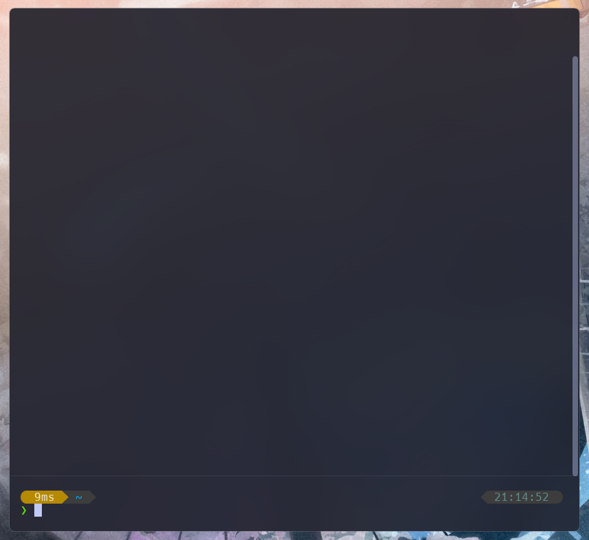

# Dotfiles

Personal dotfiles with interactive installers for macOS, Linux, and Windows development environments.

Hey there 👋 These are the dotfiles I use every day to make my work life easier. I'm always tinkering with them and finding cool new tricks to speed things up. While these tools are my personal favorites, I thought I'd share them with you - who knows, you might find some hidden gems in here too. Feel free to poke around and borrow any ideas that catch your eye. And hey, if you've got any awesome tips of your own, I'd love to hear them.

> **⚠️ Warning**: Don't blindly use my settings unless you know what that entails. Use at your own risk!

The repository bundles shell installers (Bash, Fish, and PowerShell), package lists for Homebrew, Scoop, npm, Fisher, and VS Code, editor and terminal configuration, and a set of helper scripts. An interactive menu installs packages, copies configuration files into place, and removes them again.



## Table of Contents

- [Install](#install)
- [Usage](#usage)
- [Features](#features)
- [Configuration](#configuration)
- [Limitations](#limitations)
- [Show your support](#show-your-support)
- [Author](#author)
- [License](#license)

## Install

### Prerequisites

- **macOS / Linux**: Git, Homebrew, and Bash 4 or later. `install.sh` exits on older Bash versions, including the Bash 3.2 that ships with macOS.
- **Windows**: Git and PowerShell. `install.ps1` installs Scoop itself when it is missing.

### macOS / Linux

```bash
# 1. Check if Git is installed
git --version

# 2. If Git is not installed, install Homebrew first
/bin/bash -c "$(curl -fsSL https://raw.githubusercontent.com/Homebrew/install/HEAD/install.sh)"

# 3. Install Git, and Bash 4+ for the installer
brew install git bash

# 4. Clone this repository
git clone https://github.com/jirateep12z/dotfiles.git $HOME/.dotfiles
cd $HOME/.dotfiles

# 5. Make scripts executable
chmod +x *.sh script/*.sh
```

### Windows

Use a regular (non-administrator) PowerShell window. The Scoop installer refuses to run as administrator by default.

```powershell
# 1. Check if Git is installed
git --version

# 2. If Git is not installed, install Scoop first
Set-ExecutionPolicy -ExecutionPolicy RemoteSigned -Scope CurrentUser
$scoop_installer = "$env:TEMP\install-scoop.ps1"
Invoke-RestMethod -Uri https://get.scoop.sh -OutFile $scoop_installer
& $scoop_installer
Remove-Item $scoop_installer -Force

# 3. Install Git
scoop install git

# 4. Close and reopen PowerShell, then clone this repository
git clone https://github.com/jirateep12z/dotfiles.git $ENV:USERPROFILE\.dotfiles
cd $ENV:USERPROFILE\.dotfiles
```

## Usage

### macOS / Linux

Run the installer and choose an action by number:

```bash
./install.sh
```

The menu groups actions into `INSTALL`, `UNINSTALL`, `CONFIGURE`, and `REMOVE`, and starts like this:

```text
INSTALL:
  1. Install Homebrew packages
  2. Install VSCode extensions
  3. Install Skills
  4. Install all packages
```

A typical first run:

1. Choose `1` to install Homebrew packages, which include Fish, Bash, Neovim, and Lazygit.
2. Choose `9` to make Fish the default shell.
3. Choose `19` to copy every application configuration.
4. Enter `q` to quit.

Then install Fisher, its plugins, Node.js LTS, and global npm packages from Fish:

```bash
./fisher.sh
```

`Install Skills` (option `3`) runs `npx`, so run `fisher.sh` first to get Node.js.

### Windows

```powershell
.\install.ps1
```

The Windows menu uses the same four groups, with extra actions for PowerShell modules, Node.js LTS, npm packages, PowerShell, Windows Terminal, and PHP.

### CLI

`Configure Script` copies the helper scripts in `script/` to `~/.local/bin` on macOS and Linux, or to `%USERPROFILE%\AppData\Local\script` on Windows. The installer does not add `~/.local/bin` to `PATH`.

Every helper script requires Bash 4 or later. Scripts with options print their help with `--help`:

```bash
ssh-key-manager.sh --help
```

On Windows, the `local-script` PowerShell module wraps each script as a function that runs it through `sh`, for example:

```powershell
ssh_key_manager list
```

## Features

### Interactive Installers

- **Cross-Platform Menus**: `install.sh` runs on macOS and Linux; `install.ps1` runs on Windows. Each checks the operating system before showing the menu.
- **Install and Uninstall**: Install or uninstall each package group separately, or all of them at once.
- **Configure and Remove**: Copy each application's configuration into place, or remove it, individually or all at once.
- **Failure Summary**: Batch actions continue past a failed package or step and report the failures at the end.

### Package Management

- **Homebrew**: Installs taps, packages, and fonts from `requirement/brew-*.txt`, and cask applications on macOS only.
- **Scoop**: Adds buckets and installs packages, applications, and Nerd Fonts from `requirement/scoop-*.txt`.
- **Fisher**: `fisher.sh` installs Fisher and the plugins in `requirement/fisher.txt`, such as Tide, `z`, `nvm.fish`, and `fzf.fish`.
- **Node.js and npm**: Installs Node.js LTS through `nvm` and the global npm packages in `requirement/npm.txt`, and sets the npm `allow-scripts` list for `@openai/codex` and `@anthropic-ai/claude-code`.
- **PowerShell Modules**: Installs the modules in `requirement/powershell.txt` for the current user, and installs PowerShell through `winget` when `pwsh` is missing.
- **VS Code Extensions**: Installs the extensions in `requirement/code.txt`.
- **Agent Skills**: Installs the Claude Code skills in `requirement/skills.txt` globally with `npx skills add`.

### Shell and Terminal

- **Fish Default Shell**: Adds Fish to `/etc/shells`, sets it as the login shell, and adds Homebrew to the Fish path.
- **PowerShell Profile**: Loads an Oh My Posh theme, PSReadLine Emacs key bindings, `eza` listing functions (`ls`, `la`, `ll`, `lla`), and aliases such as `g` for Git and `lg` for Lazygit.
- **Command History Module**: Includes a `command-history` PowerShell module that the profile imports.
- **Windows Terminal**: Replaces `settings.json` for Windows Terminal.
- **Terminal Themes**: Provides Tokyo Night, Tokyo Night Storm, and Solarized Dark themes for Warp and iTerm2. The installer copies the Warp themes; the iTerm2 color files are imported manually.

### Editors and Developer Tools

- **Neovim**: A LazyVim-based configuration with extra multi-cursor and UI modules.
- **Vim**: A `.vimrc` for Vim.
- **VS Code**: Settings and keybindings for VS Code, including the Scoop VS Code data path on Windows.
- **Lazygit**: A Lazygit `config.yml`.
- **Commitizen**: A `.czrc` that uses the `cz-git` adapter.
- **Python (pip)**: A `pip.conf` that sets `break-system-packages = true`. On Windows it is installed as `pip.ini`, the file name pip reads there.
- **PHP (Windows)**: Updates the Scoop PHP `php.ini` with the extensions and limits in `config/php/php.ini`, and sets `PHPRC`.

### Git

- **Git Aliases**: Short aliases such as `st`, `cm`, `cb`, and `pl` / `ps` for pulling and pushing the current branch.
- **Per-Provider Identities**: Prompts for a GitHub and a GitLab folder, name, and email, then uses `includeIf "gitdir/i:..."` so each folder commits with its own identity.
- **Identity Enforcement**: Sets `user.useConfigOnly = true`, so Git refuses to commit where no identity is configured.

### Helper Scripts

- **`cleanup-directories.sh`**: Deletes files from personal and temporary folders, such as `Downloads`, `Music`, screenshots, application caches and logs, the Trash, and temp folders, depending on the operating system. It runs as a dry run unless you pass `--force`, and filters by age, size, extension, and exclusion pattern.
- **`ide.sh`**: Splits the current tmux window into a `default`, `wide`, `tall`, or `quad` layout.
- **`ssh-key-manager.sh`**: Generates, lists, copies, tests, and deletes SSH keys, manages the SSH agent, and edits `~/.ssh/config` host entries.
- **`initialize-command-history.sh`** and **`sort-command-history.sh`**: Initialize, sort, and deduplicate Fish and PowerShell command history, with a dry run by default and optional backups.
- **`youtube-downloader.sh`**: Downloads YouTube videos, audio, and playlists with `yt-dlp` and `ffmpeg`.
- **`video-transcription.sh`**: Transcribes or translates video and audio files with Whisper into `srt`, `vtt`, `txt`, `json`, or `tsv`, for a single file or a whole directory.
- **`resize-dock.sh`**: Shows, sets, or resets the macOS Dock tile size (20 to 100).
- **`reinstall-anydesk.sh`**: Removes and reinstalls AnyDesk to get a new ID while keeping the remote address list, with a dry run by default.
- **`get-open-with-manager.sh`**: Lists and removes Windows "Open with" registry entries, including entries for missing programs.

## Configuration

Package lists live in `requirement/`, one entry per line. The installers skip blank lines and lines that start with `#`. Edit these files to change what gets installed:

| File                                                | Used by                     |
| --------------------------------------------------- | --------------------------- |
| `brew-tap.txt`, `brew-package.txt`, `brew-font.txt` | `install.sh`                |
| `brew-application.txt`                              | `install.sh` (macOS only)   |
| `scoop-bucket.txt`, `scoop-package.txt`             | `install.ps1`               |
| `scoop-application.txt`, `scoop-font.txt`           | `install.ps1`               |
| `powershell.txt`                                    | `install.ps1`               |
| `npm.txt`                                           | `install.ps1`, `fisher.sh`  |
| `fisher.txt`                                        | `fisher.sh`                 |
| `code.txt`                                          | `install.sh`, `install.ps1` |
| `skills.txt`                                        | `install.sh`, `install.ps1` |

Application configuration lives in `config/`, one folder per application. `Configure Git` uses `.gitconfig` at the repository root.

## Limitations

- **Configuration is replaced, not merged**: `Configure` actions delete existing files before copying. For Neovim, Lazygit, and pip, and for the script folder on Windows, the whole destination folder is deleted first. VS Code loses every `.json` file in its user folder, and `Configure Git` replaces `~/.gitconfig`. Back up your own configuration before running them.
- **Remove deletes whole folders**: `Remove` actions for Neovim, Lazygit, and pip, and for PowerShell and the script folder on Windows, delete the destination folder, not only the files this repository added. On Windows this includes everything in `Documents\PowerShell` and `Documents\WindowsPowerShell`.
- **Undeclared script dependencies**: `youtube-downloader.sh` needs `yt-dlp`, and `video-transcription.sh` needs Whisper (`openai-whisper`). Neither is in the package lists.
- **Platform-specific scripts**: `resize-dock.sh` targets macOS, and `get-open-with-manager.sh` runs only on Windows through Git Bash, MSYS, or Cygwin.

## Show your support

Give a ⭐️ if this project helped you!

## Author

**Made with ❤️ by @jirateep12z**

## License

This project is licensed under the **MIT License** - see the [LICENSE](LICENSE) file for details.

Copyright (c) 2026 Jirateep Lumvasana
